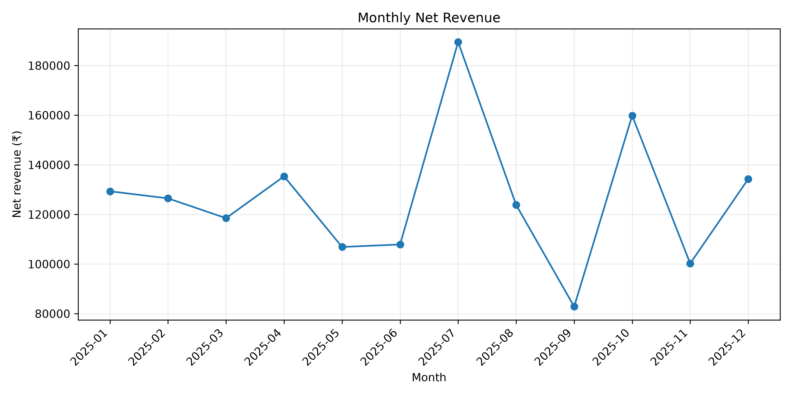
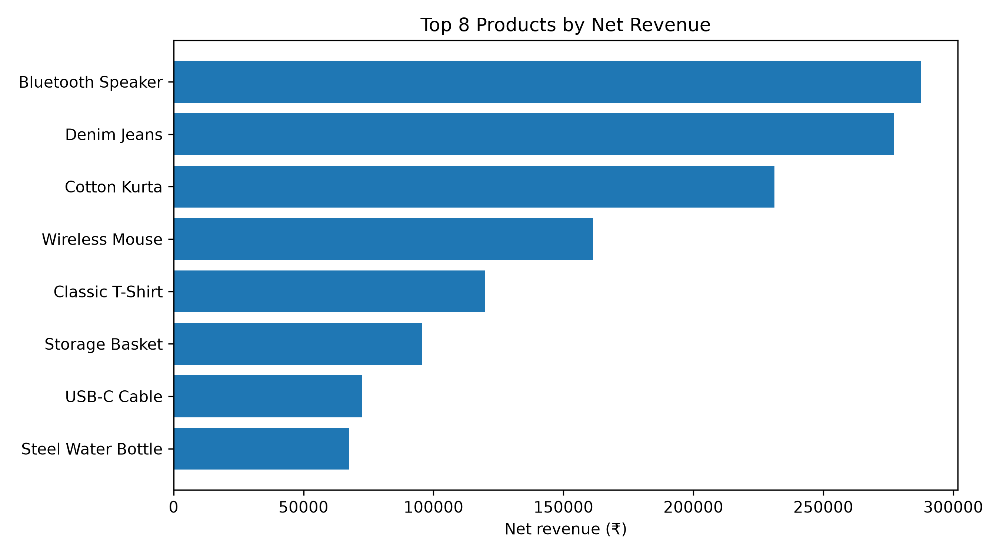
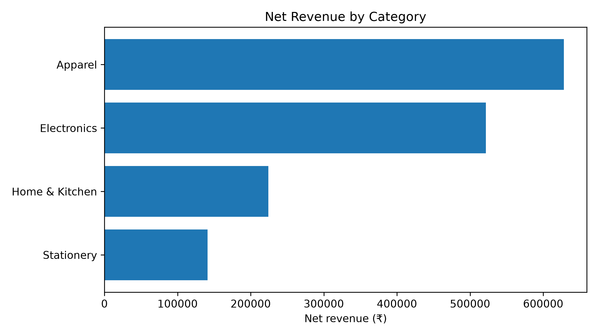

# Business Sales Analysis

## Project Overview
An end-to-end business sales analysis project using Python to explore retail sales data, identify revenue trends, evaluate product performance, and generate actionable business recommendations.

This project demonstrates how data analysis can help businesses make informed decisions about products, categories, regions, and sales performance.

## Objectives
- Clean and prepare raw sales data.
- Analyze product-wise revenue.
- Identify top-performing product categories.
- Examine monthly revenue trends.
- Compare regional sales performance.
- Generate actionable business recommendations.

## Technologies Used
- Python
- Pandas
- NumPy
- Matplotlib
- Jupyter Notebook

## Project Structure

```text
Business-Sales-Analysis/
│
├── business_sales_analysis.ipynb
├── messy_retail_sales.csv
├── cleaned_retail_sales.csv
├── product_performance.csv
├── monthly_revenue.csv
├── monthly_revenue.png
├── top_products.png
├── category_revenue.png
└── README.md
```

## Key Business Insights

1. **Category Performance:** Apparel generated the highest net revenue, followed by Electronics.
2. **Product Performance:** Bluetooth Speaker was the highest-revenue product in the analyzed dataset.
3. **Monthly Trends:** July recorded the highest monthly revenue, while September recorded the lowest.
4. **Business Recommendations:** Monitor inventory for high-performing products, investigate low-revenue periods, and evaluate regional performance before allocating additional resources.

## Visualizations

### Monthly Revenue Trend


### Top Products by Revenue


### Revenue by Category


## How to Run the Project

1. Clone or download this repository.
2. Install the required libraries:

```bash
pip install pandas numpy matplotlib jupyter
```

3. Open Jupyter Notebook:

```bash
jupyter notebook
```

4. Open `business_sales_analysis.ipynb`.
5. Run all cells.

## Dataset Note
This project uses a synthetic retail sales dataset created for learning and demonstration purposes. The findings should not be interpreted as actual business results.

## Author
**Sanjay Ganesh G**

Aspiring AI/ML Engineer | Python | Machine Learning | Data Analysis